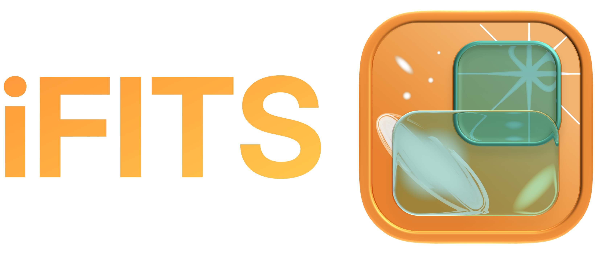
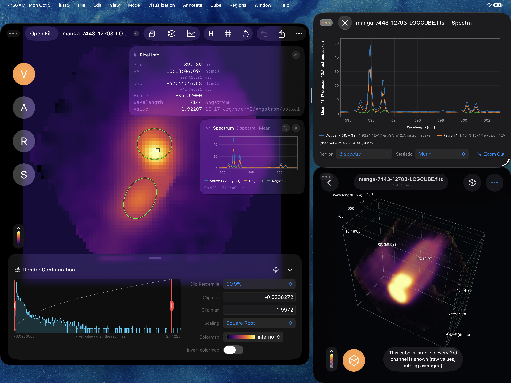

# iFITS — Astronomy Image Visualization and Viewer for iPadOS

---

**Author:** Derod Deal (dealderod@gmail.com)

`iFITS` is an iPadOS app in development designed to view and render 2D and 3D FITS images using the Swift programming language. Users of this app can use the iPad to pinch and zoom FITS images, apply different color mappings, write and save annotations with the Apple Pencil, and create regions for basic statistical analysis. This app takes advantage of iPad-specific features such as AR capabilities for viewing cube images in 3D spaces and utilizing iPadOS window multitasking.

## Statement of need

Many students, astronomers, and astrophysicists utilize iPads to take handwritten digital notes, read research papers, annotate papers, communicate ideas, and much more. However, to view FITS files locally, you need another device running Linux, macOS, or Windows. With the rising costs of computers, aspiring astronomers who own an iPad but not a desktop or laptop cannot access FITS files locally. iPadOS also offers a wide range of APIs and software frameworks that could benefit both aspiring astronomers and established researchers. `iFITS` is a developing, open-source, and free iPad app that allows users to load and open FITS images, render images with customizable visualizations, use simple yet robust cube analysis and statistics features, annotate FITS images directly using the Apple Pencil, and visualize cube data using ARKit. Additionally, `iFITS` has potential to be utilized in classrooms and by the public.

## Installation

Users can download this app on the App Store (https://apps.apple.com/us/app/ifits-fits-image-viewer/id6820193593) or download this repository and build the app on an iPad running iPadOS 27 or later using Xcode 27+.

## Quick start

1. **Open a FITS file.** Tap **Open File** at the top left, or in the Files app touch and hold a `.fits` file and choose **Open With › iFITS**. You can also drag a file onto the iFITS window. Pinch to zoom, drag to move, and tap ↺ to reset the view. 

https://github.com/user-attachments/assets/f295cccb-266f-410b-8453-2d7a38829231

2. **Change how the image looks (V).** In the **Render Configuration** panel, pick a colormap and a scaling (Linear, Log, Square Root, Squared, Gamma or Power), and set the clip range with a percentile or the red lines on the histogram.

https://github.com/user-attachments/assets/b3332e35-23fd-4d07-afd0-7d99eea99cb9

3. **Annotate (A).** Draw on the image with Apple Pencil. Annotations are saved inside the FITS file.

https://github.com/user-attachments/assets/0e92dcba-f78c-4100-bbf4-0c169a46b8a3

4. **Regions and statistics (R, S).** Draw an ellipse, rectangle, line or point, then see its statistics in **S** mode. Regions can be imported and exported as DS9 `.reg` files.

https://github.com/user-attachments/assets/e22c3bc6-2e52-4e2d-bbf4-54d4b5a7e2d1

5. **FITS header.** Tap **H** to see every keyword and value.

https://github.com/user-attachments/assets/efb23d9e-d74e-4ea9-8f43-2abe0dccadc2

6. **Data cubes.** For a cube, tap the cube button to play or step through the channels.

https://github.com/user-attachments/assets/3424cfbf-b460-4774-b983-d7eaedefe14a

7. **Spectra.** Tap the spectrum button, then hover over or double-tap a pixel, or pick a region, to see its spectrum.

https://github.com/user-attachments/assets/ed2d7d5e-7b57-461f-b1b7-11944340f914

8. **3D view and AR.** Tap the AR button to rotate the cube in 3D, then tap **Place the cube in the room** to see it through the camera.

https://github.com/user-attachments/assets/ec0a6767-5a6a-4f4e-8134-5436498c5f72

Annotations and regions save automatically (turn off **Autosave** in **••• › Settings**). Use the share button to send the FITS file, or **Export and Send…** for a PNG or JPEG.

## License and attribution

This project is under the GPL-3.0 license, which can be viewed [here](https://github.com/GalagaBits/iFITS/blob/main/LICENSE).

## Disclosures and Comments

This project is an outlet for me to learn agentic coding, Swift, and Metal. Currently, the majority of this software is generated by Claude Code using Opus 5.5. I am also using this project as an opportunity to learn Swift and Metal programming to create more iOS apps, both from scratch without AI and with AI-assisted coding. As a result, the current state of the app may not be suitable for research publications, as values and calculations might differ from those of reputable astronomy software such as DS9 and CARTA. Nevertheless, I strive to make this software as accurate as possible by comparing it with reputable software and running Python/Astropy tests, understanding each line of code, and working towards making `iFITS` a reliable and accurate tool. 

## Data credits

This work made use of THINGS, 'The HI Nearby Galaxy Survey' ([Walter et al. 2008](https://ui.adsabs.harvard.edu/abs/2008AJ....136.2563W/abstract)) in images and presentations. The FITS files were retrieved from [this link](https://things.www3.mpia.de//Data.html). Galaxy NGC 2403. Data cube: BBarolo example data (https://editeodoro.github.io/Bbarolo/downloads/examples/); Fraternali, Oosterloo & Sancisi 2004, A&A, 424, 485. B-band image (KPNO 0.9 m telescope): Cook et al. 2014, MNRAS, 445, 881, obtained through the NASA/IPAC Extragalactic Database (NED), which is funded by NASA and operated by the California Institute of Technology. 

Screenshots and demos use the MaNGA data cube of galaxy 7443-12703 from SDSS Data Release 17
([download](https://data.sdss.org/sas/dr17/manga/spectro/redux/v3_1_1/7443/stack/manga-7443-12703-LOGCUBE.fits.gz)),
produced by the MaNGA Data Reduction Pipeline (Brian Cherinka & David Law). SDSS DR17: Abdurro'uf et al. 2022, ApJS, 259, 35.

Funding for the Sloan Digital Sky Survey IV has been provided by the Alfred P. Sloan Foundation,
the U.S. Department of Energy Office of Science, and the Participating Institutions.

SDSS-IV acknowledges support and resources from the Center for High Performance Computing at the
University of Utah. The SDSS website is www.sdss4.org.

SDSS-IV is managed by the Astrophysical Research Consortium for the Participating Institutions of
the SDSS Collaboration including the Brazilian Participation Group, the Carnegie Institution for
Science, Carnegie Mellon University, Center for Astrophysics | Harvard & Smithsonian, the Chilean
Participation Group, the French Participation Group, Instituto de Astrofísica de Canarias, The
Johns Hopkins University, Kavli Institute for the Physics and Mathematics of the Universe (IPMU) /
University of Tokyo, the Korean Participation Group, Lawrence Berkeley National Laboratory,
Leibniz Institut für Astrophysik Potsdam (AIP), Max-Planck-Institut für Astronomie (MPIA
Heidelberg), Max-Planck-Institut für Astrophysik (MPA Garching), Max-Planck-Institut für
Extraterrestrische Physik (MPE), National Astronomical Observatories of China, New Mexico State
University, New York University, University of Notre Dame, Observatório Nacional / MCTI, The Ohio
State University, Pennsylvania State University, Shanghai Astronomical Observatory, United Kingdom
Participation Group, Universidad Nacional Autónoma de México, University of Arizona, University of
Colorado Boulder, University of Oxford, University of Portsmouth, University of Utah, University of
Virginia, University of Washington, University of Wisconsin, Vanderbilt University, and Yale
University.
