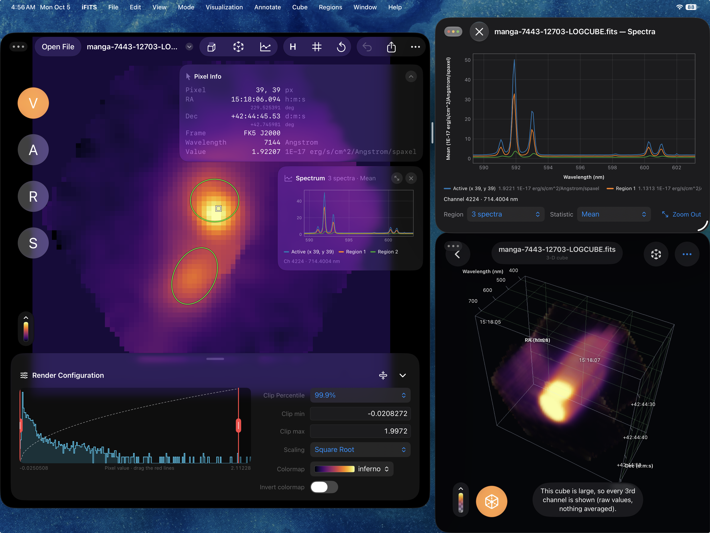

# iFITS

iFITS is a free, open-source app for viewing and analysing 2D images and 3D data cubes in the FITS format, on iPad and iPhone.

---

## Quick start

### 1. Open a FITS file

Tap **Open File** at the top left and choose a `.fits` file. You can also:

- In the **Files** app, touch and hold a FITS file, then choose **Open With › iFITS**.
- Drag a FITS file onto the iFITS window.

Pinch to zoom and drag to move around. Tap ↺ to reset the view. Tap or hover over a pixel to see its value and sky position in **Pixel Info**.

<video src="assets/videos/01-open-from-files.mp4" autoplay loop muted playsinline controls width="720" style="max-width:100%" aria-label="Opening a FITS file from the Files app"></video>

### The four modes

The **V A R S** buttons on the left switch between the four modes. The orange one is the mode you're in.

### 2. Change how the image looks (V)

In **V** (Visualization) mode, the **Render Configuration** panel at the bottom controls the image:

- **Colormap:** inferno, viridis, gray and more. Turn on **Invert colormap** to flip it.
- **Scaling:** Linear, Log, Square Root, Squared, Gamma or Power.
- **Clip:** pick a percentile, or drag the red lines on the histogram.

<video src="assets/videos/02-tune-the-display.mp4" autoplay loop muted playsinline controls width="720" style="max-width:100%" aria-label="Changing scaling, clipping and colormap"></video>

### 3. Annotate (A)

In **A** (Annotation) mode, draw on the image with Apple Pencil. Use the toolbar to pick a color, turn finger drawing on, hide your notes or clear them. Annotations are saved inside the FITS file.

<video src="assets/videos/03-annotate.mp4" autoplay loop muted playsinline controls width="720" style="max-width:100%" aria-label="Drawing on an image with Apple Pencil"></video>

### 4. Draw regions and get statistics (R and S)

In **R** (Regions) mode, pick a shape (ellipse, rectangle, line or point) and drag on the image, or tap for a default size. Tap a region to edit its name, color and position. Use **Import / Export Regions (.reg)** to share regions with DS9.

In **S** (Statistics) mode, see the statistics of the selected region or of the entire image.

<video src="assets/videos/04-regions-statistics.mp4" autoplay loop muted playsinline controls width="720" style="max-width:100%" aria-label="Drawing a region and reading its statistics"></video>

### 5. Read the FITS header

Tap **H** in the toolbar to see every header keyword and value. On iPad, choose **File › Show Header in New Window** (⌥⌘H) to keep it open beside the image.

<video src="assets/videos/05-fits-header.mp4" autoplay loop muted playsinline controls width="720" style="max-width:100%" aria-label="Opening the FITS header"></video>

### 6. Step through a data cube

When the file is a cube, the cube button in the toolbar turns on. Tap it to open the **Animator**: play the channels, step one at a time, or drag the slider. You can also change the frame rate.

<video src="assets/videos/06-data-cubes.mp4" autoplay loop muted playsinline controls width="720" style="max-width:100%" aria-label="Stepping through the channels of a cube"></video>

### 7. See a spectrum

For a spectral cube, tap the spectrum button (the line chart) in the toolbar. Hover over or double-tap a pixel to see its spectrum. To get the spectrum of a whole area, draw a region in **R** mode, then pick it in the spectrum panel and choose the statistic, such as the mean. You can overplot several spectra. Drag the orange line to change channel.

<video src="assets/videos/07-spectra.mp4" autoplay loop muted playsinline controls width="720" style="max-width:100%" aria-label="Pulling a spectrum from a region"></video>

### 8. View the cube in 3D

Tap the AR button in the toolbar. Drag to rotate, pinch to zoom, twist to roll and double-tap to reset. The options button changes the opacity, value range and depth.

<video src="assets/videos/08-3d-view.mp4" autoplay loop muted playsinline controls width="720" style="max-width:100%" aria-label="Rotating a cube in 3D"></video>

### 9. Place the cube in your room (AR)

In the 3D view, tap **Place the cube in the room**. Move your device slowly, then tap a table or the floor. Pinch to resize the cube and drag to turn it. iFITS asks for camera access the first time. It only uses the camera live, and never records.

<video src="assets/videos/09-augmented-reality.mp4" autoplay loop muted playsinline controls width="720" style="max-width:100%" aria-label="Placing a cube in the room with augmented reality"></video>

### 10. Open spectra in their own window

On iPad, tap the open-in-new-window button in the spectrum panel to show the spectra in a separate window beside the image.

<video src="assets/videos/10-spectra-window.mp4" autoplay loop muted playsinline controls width="720" style="max-width:100%" aria-label="Spectra in their own window"></video>

---

## Save and share

- **Saving:** annotations and regions are saved into your FITS file automatically. To save only when you choose, turn off **Autosave** in **••• › Settings** and press **⌘S**.
- **Share:** the share button sends the FITS file. Choose **Export and Send…** to send a PNG or JPEG of the image as you see it.

## Keyboard shortcuts

| Shortcut | Action |
|:--|:--|
| ⌘O | Open a FITS file |
| ⌘S | Save |
| ⌘1, ⌘2, ⌘3, ⌘4 | V, A, R and S modes |
| ⌘= and ⌘− | Zoom in and out |
| ⌘0 | Reset view |
| ⇧⌘G | Show or hide the coordinate grid |

## Need help?

See [Support](support/), or [open an issue on GitHub](https://github.com/GalagaBits/iFITS/issues).
